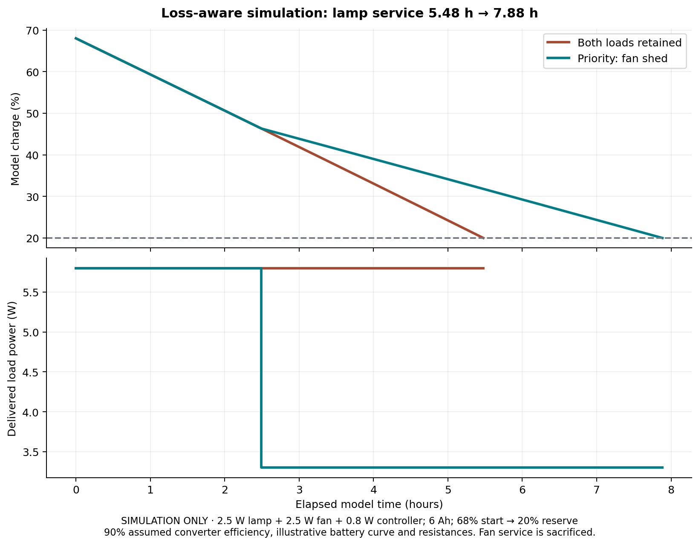
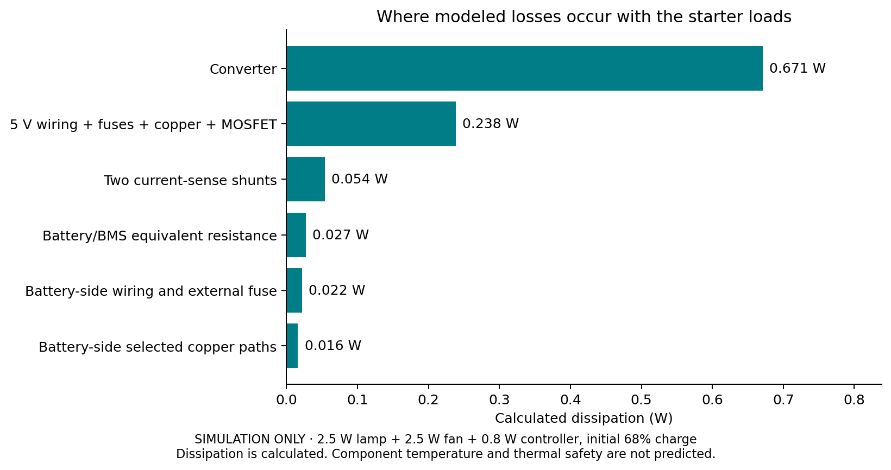
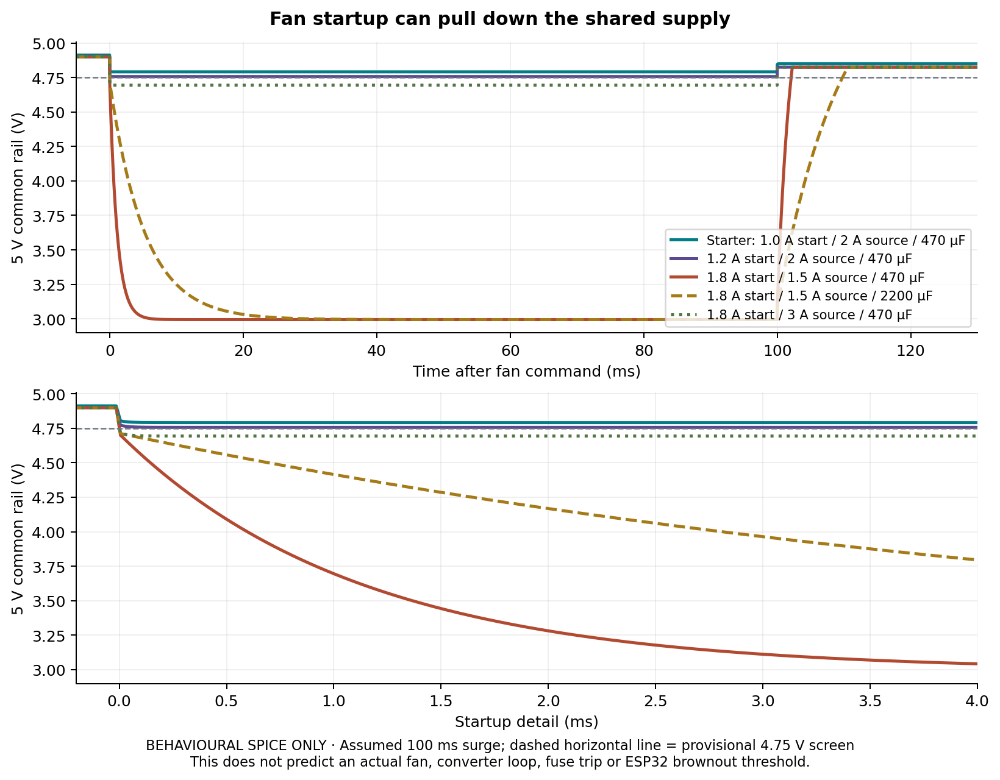

# Wattsense hardware-performance simulation

28 September 2026. **Simulated predictions and screening cases only. No parts have been purchased and no physical hardware has been tested.** These models extend the earlier ideal battery and reduced-circuit work. They do not replace it or turn it into experimental evidence.

## Main result

For an illustrative 6 Ah pack starting at 68% charge, stopping at an independently known 20% reserve, with a **2.5 W lamp, 2.5 W fan, 0.8 W controller/sensors and 90% converter efficiency**:

| Operating policy | Lamp service | Fan service | Result |
| --- | ---: | ---: | --- |
| Keep both loads until the common endpoint | 5.48 h | 5.48 h | Comparison baseline |
| Priority control, 3 h backup setting | 7.88 h | 2.49 h | Fan is shed at 2.49 h; lamp continues |

The lamp runs about **44% longer in this model because the fan is switched off earlier**. The battery has not gained capacity. This percentage is specific to the initial charge, loads and policy; it is not a guaranteed product improvement. The same endpoint consumes approximately 37.41 Wh of modeled battery energy in both runs.



The earlier ideal-model 4.88 h / 7.25 h numbers used **3 W** loads and omitted these losses. An additional like-for-like 3 W run with the new model gives **4.62 h / 7.15 h**, but its constant-power branch currents exceed the initial 0.6 A target. It is retained only for comparison. Use the smaller starter loads for the physical build.

## What the model contains

- An illustrative open-circuit-voltage versus charge curve and lumped battery/BMS resistance.
- Battery-side wiring/contact/external-fuse resistance, two actual 0.1 ohm sensing shunts, and converter efficiency.
- Selected **actual Rev B trace geometries**, extracted read-only from KiCad and converted to resistance with R = rho L / area.
- Main and branch fuse nominal cold resistances, an AO3400A room-condition on-resistance reference and assumed load wiring.
- Constant delivered power for the lamp, fan and controller during discharge; the controller's 0.8 W includes its sensors and 3.3 V conversion losses.
- The Python reference policy in a closed loop with that plant. Production C++ policy tests are separate; this is not instruction-level ESP32 simulation.
- Six separate ngspice startup scenarios with an assumed current-limited supply, capacitance/ESR and voltage-dependent fan demand.

All adjustable assumptions and source links are in `simulations/hardware-assumptions.json`. Raw traces, summaries and selected copper paths are in `simulations/results/`. The battery curve, capacity, wiring, fan demand and module efficiency **have not been measured**. The supplied curve must not be used to infer LiFePO4 charge from voltage on real hardware.

The copper calculation follows explicit front-layer paths and omits parallel pours/inner ground planes, pad spreading and contact resistance. The power model groups these into a common return and two load branches; it is not a full field solution of the board. It compares assumed 35 micrometre copper at 20 C against 25 micrometre copper at 60 C. **60 C is an input sensitivity case, not a predicted board temperature.** Fuse heating, semiconductor temperature dependence, loop response, parasitics, ripple, EMI and physical protection trips are not modeled.

## Steady-load findings

At the illustrative initial charge, with the 2.5 W starter loads:

| Quantity | Calculated value |
| --- | ---: |
| Total converter output current | 1.208 A |
| Lamp / fan current | 0.517 A / 0.527 A |
| Common 5 V rail after shared losses | 4.885 V |
| Lamp / fan terminal voltage | 4.834 V / 4.746 V |
| Battery current | 0.520 A |
| Buck input voltage | 12.912 V |
| Converter dissipation at assumed 90% efficiency | 0.671 W |
| 5 V wiring, fuses, copper and MOSFET dissipation together | 0.238 W |
| Two battery/load shunts together | 0.054 W |
| Fan MOSFET conduction loss, already included above | 0.013 W |

These figures identify loss sources; they do **not** predict component temperature. At 3 W delivered to each load, the modeled currents become about 0.625 A and 0.639 A. Therefore buy roughly **2.5 W / 0.5 A class loads initially**, verify their permitted voltage range and measure the actual branch currents. The initial measured branch ceiling remains 0.6 A each; total continuous 5 V current remains at most 1.5 A, including the ESP32 if battery-powered. Four layers do not raise these limits.



## Startup finding: converter rating alone is insufficient

In these scenarios the fan's assumed high demand lasts 100 ms. The supply has a 40 milliohm equivalent output resistance, a chosen current limit and an assumed external-module capacitor with 50 milliohm ESR. This is **not** a model of the purchased module (none exists yet), its switching loop or an actual BLDC fan.

| Scenario | Minimum common rail | Minimum fan terminal | Common-rail screen |
| --- | ---: | ---: | --- |
| Starter: lamp 0.5 A, fan 0.5 A running / 1.0 A startup; 2 A source, 470 uF | 4.791 V | 4.551 V | Pass in model, limited margin |
| Lamp 0.6 A, fan 0.6 A with no surge; 2 A source, 470 uF | 4.825 V | 4.677 V | Pass in model |
| Same loads, fan 1.2 A startup; 2 A source, 470 uF | 4.756 V | 4.474 V | Barely passes in model |
| Same loads, fan 1.8 A startup; 1.5 A source, 470 uF | 2.995 V | 2.736 V | Fails |
| Same 1.8 A startup and 1.5 A source, increased to 2200 uF | 2.995 V | 2.736 V | Still fails |
| Same 1.8 A startup, 3 A source, 470 uF | 4.694 V | 4.288 V | Fails from series drop despite source headroom |

The provisional common-rail screening floor is **4.75 V**, not a universal ESP32 reset threshold or fan specification. Passing that screen does not establish fan startup, absence of reset or fuse pulse survival. Fan terminal voltage can be substantially lower. The startup model uses resistive demand that decreases during undervoltage; a real fan can stall, restart or draw differently. It may perform worse.

The larger capacitor delays the drop but cannot sustain a 100 ms current deficit. Do not change a module's capacitors merely from this experiment: actual converter stability depends on capacitance, ESR, layout and control behavior. TI discusses these dependencies in its [LM2596 datasheet](https://www.ti.com/lit/ds/symlink/lm2596.pdf), sections 9.1.3 and 9.2. This is why the selected module and exact loads need a real startup test.



Select a low-startup-current fan first. Test the complete lamp + fan + controller arrangement, short wiring and proper rail distribution. Source current capability must have measured transient margin; this does not authorize increasing PCB/fuse continuous limits. The 2 A/3 A source settings above are scenario inputs, not buying recommendations or new board ratings. Do not oversize fuses to conceal a startup problem.

## Sensitivity and numerical checks

Eighteen paired cases cover 4.8/6 Ah, 80/90/95% efficiency, and 0.05/0.10/0.20 ohm battery/BMS equivalent resistance with the starter loads. Baseline lamp service spans **3.87–5.80 h**; priority lamp service spans **6.28–8.20 h**. These are endpoints of selected scenarios, not confidence intervals or guaranteed bounds. Each case assumes its actual capacity is correctly entered in the estimator. Unknown capacity/sensor offset remains a separate problem; the previous report demonstrates that error.

Checks include electrical power conservation, analytical constant-power solutions, no-load/ideal-source limits, invalid operating points, and independent DC/Kirchhoff checks against every startup SPICE case. Reducing the discharge step from 1 s to 0.25 s changes baseline runtime by 0.50 s and priority runtime by 0.75 s. This supports numerical consistency of the chosen equations, not the accuracy of unmeasured parameters.

The full suite now contains **45 Python tests and 67 C++ assertions**, the nine earlier reduced circuits, six new startup circuits, ideal and nonideal plant runs, and plots. `suite-summary.json` is the authoritative result for the most recent execution. Some startup scenarios deliberately fail their voltage screen; a passing suite means those counterexamples were detected as expected, not that all candidate hardware configurations are acceptable.

## What must still be measured

1. Actual pack capacity and discharge curve, plus current/voltage calibration against independent instruments.
2. Converter input/output power, regulation and temperature at the actual load and battery-voltage range.
3. Fan startup current and duration; minimum common rail, fan terminal and ESP32 3.3 V rail. Borrow a lab oscilloscope for this: the dashboard's 1 Hz reports cannot resolve the transient.
4. Reset behavior and OFF behavior; repeated starts and fuse pulse suitability for the exact loads and ambient conditions.
5. Steady temperatures on the shunts, fuses, terminals, MOSFET and converter; the battery probe alone does not measure these.
6. Measured baseline versus priority trials at the same independently tracked endpoint. The essential lamp is not automatically disconnected by this board; the operator must stop the trial at the endpoint.

No new PCB was required by this modeling exercise. Keep Rev B unchanged until the real load/module choice and mentor review establish whether a wiring, supply or routing change is needed. Simulation found selection constraints; it did not validate a fabrication release or a battery protection system.

## Reproduce and inspect

From the project root:

```powershell
.\run_simulations.ps1
```

For just this new model and its figures:

```powershell
.\.venv\Scripts\python.exe simulations\run_hardware.py
.\.venv\Scripts\python.exe simulations\make_hardware_plots.py
```

KiCad Python and its ngspice DLL are required. `KICAD_PYTHON` and `NGSPICE_DLL` can override the installed paths. `hardware-summary.json` and `copper-resistance.json` record source/PCB hashes; the full suite also hashes the assumptions file. Editing assumptions requires rerunning and updating this written interpretation.

Component inputs come from [Littelfuse 466](https://www.littelfuse.com/assetdocs/littelfuse_fuse_466_datasheet?assetguid=dbe9bcd7-6072-4adf-bf5b-d33e52a6b90f) nominal cold resistances (0.030 ohm for 2 A; 0.075 ohm for 1 A), and [AO3400A](https://www.aosmd.com/res/data_sheets/AO3400A.pdf) room-condition 48 milliohm maximum at 2.5 V gate drive. These inputs do not cover fuse hot resistance or MOSFET heating. Copper resistivity/temperature coefficients are conventional assumed bulk values, not a measurement of the board material.
