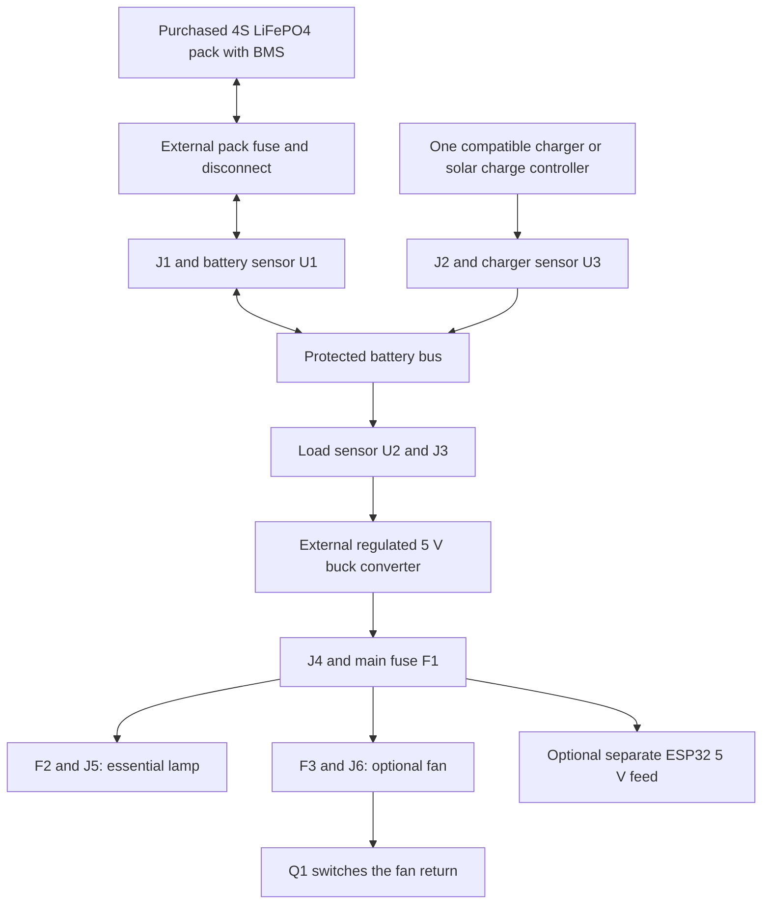

# How Wattsense works, from power-on to the final experiment

**Scope expanded on 3 October 2026:** [The current AC and DC roadmap](EXPANDED_SCOPE_AC_DC.md) covers household appliance signatures, real-power energy estimation and compatible battery/inverter runtime evaluation. The flow below is the retained small DC foundation, including its lamp/fan simulation and control policy. It is not the complete expanded architecture and supplies no AC recognition evidence. The Rev B PCB cannot connect to mains or carry household-inverter battery current; new appropriately rated sensing and a documented isolated AC data interface are required.

The project measures a small battery system and switches off a less important load when estimated backup time becomes too short. In our demonstration, **the lamp is essential and the fan is optional**. The contribution is sensing, calibrated charge/runtime estimation, local control, a custom PCB and an experimentally measured service-time tradeoff.

It can be a suitable final-year electronics project when the team assembles it, calibrates it, explains its limits and reports real comparisons. The current software, PCB design and simulations are preparation; no physical prototype exists yet.

## Where electricity flows

This is a functional flow diagram, not a wiring schematic. Use `hardware/REFERENCE_WIRING.md` and Rev B's assembly guide for connector pins and returns. J6's switched return must not be bypassed with another ground connection.

The BMS stays inside the purchased protected pack. It handles pack protection according to its own specifications. The matched charger controls charging. Our PCB measures the power paths and controls the fan; **it is not a charger or a custom BMS**. Raw solar panels must never connect directly to the battery/charger terminal. Add a verified 4S LiFePO4-compatible solar controller later, after the basic battery experiment works. Only one charging source goes to J2 at a time.

For early tests the college current-limited supply replaces the disconnected battery. The ESP32 can use USB power with JP1 open. For eventual stand-alone operation it needs the documented separate 5 V feed and a verified arrangement that prevents USB VBUS backfeeding. The laptop is for display/logging; it is not the power-control decision maker. If USB is the ESP32's only power source, disconnecting the laptop turns that controller off.

## Where information flows

1. **INA219 sensors** report battery current/voltage, converter input power and optionally charger current. Positive battery current means discharge; negative means charging.
2. **DS18B20** reports the temperature at the battery surface where it is attached. It does not measure every hot component.
3. **ESP32** validates readings, integrates signed current into a charge estimate and calculates runtime above the configured 20% reserve. It evaluates the policy about ten times per second.
4. **GPIO25 drives the existing Q1 circuit** to switch the optional fan. No additional switching PCB is needed for this scope.
5. **USB serial → Python collector → local browser dashboard** displays readings and stores CSV evidence, about once per second. Hardware-mode dashboard controls are read-only; physical buttons/authorized serial commands are handled by the ESP32.

The third channel is named `solar` in software but energy from a mains charger is not solar energy. Its production flag stays off until an actual qualified solar setup is installed.

## What happens when you turn it on

| Step | Device behavior | Why |
| --- | --- | --- |
| Power-up/reset | Fan command OFF; charge estimate unknown | A restart must not pretend to know stored charge |
| Diagnostic bring-up | Raw sensor and button readings; fan remains OFF | Check wiring, polarity, addresses and calibration first |
| Physical system qualified | Review configuration and enable the production hardware flag | The shipped `HARDWARE_CONFIRMED=false` deliberately prevents physical fan operation |
| Verified full charge and valid readings | Operator holds the full-reference button for 5 s, subject to firmware voltage/current checks | Creates the charge reference; the software does not automatically discover full charge |
| Operator requests fan ON | Controller checks temperature, voltage, charge and prospective full-load runtime | Prevents restoration from immediately exhausting the reserve |
| Normal operation | Lamp and permitted fan run; signed battery current updates the estimate | Runtime changes with power demand and available stored energy |
| Estimated no-solar runtime below 3 h for 3 s | Fan OFF, lamp remains powered | Sacrifice optional service to extend essential service |
| Conditions recover | Fan remains OFF until an explicit restore request passes its margin check | Avoid repeated on/off cycling |
| Invalid sensor, unsafe configured threshold or lost reference | Optional fan OFF; fault/unknown status shown as applicable | Software cannot make a valid energy decision from bad data |
| Common experimental endpoint reached | Operator stops the whole trial | This board does not disconnect the essential lamp automatically |

The full-reference voltage/current conditions are a guard, not proof of a full battery. Follow the pack supplier's actual charging procedure first. Reboot or invalid samples can invalidate the charge estimate; re-establish it using the documented procedure rather than inventing a percentage.

The priority decision uses a **runtime heuristic assuming no future charge input**. It uses nominal remaining energy and measured load-branch power and omits some upstream losses, so it is not a guaranteed minimum runtime. Incoming solar may replenish the pack, but the controller does not promise that sunlight will continue. All thresholds and the assumed capacity require qualification for the selected pack and loads.

## The experiment you will show

Use the same starting reference, actual loads, controller supply arrangement and independent stopping criterion for both trials:

1. Baseline: `MIN_H 0` removes early runtime-based shedding while retaining other limits. Restore the fan after a valid reference.
2. Priority: `MIN_H 3` lets the firmware shed the fan when the backup-time condition persists.
3. Record lamp service time, fan service time, current/voltage, delivered energy, temperatures and switching events. Stop at the independently tracked 20% reserve or an earlier normal operating limit.
4. Compare repeated measurements and report the loss of fan service alongside any lamp-runtime improvement. Battery capacity has not increased.

The current nonideal simulation predicts **5.48 h versus 7.88 h of lamp service**, with the priority fan turning off at **2.49 h**, for its stated assumptions. Read `HARDWARE_PERFORMANCE.md` before presenting those values. They are simulated, not physical results or a runtime guarantee.

## What to do next, in order

1. **Now:** run the simulator, understand this flow, inspect the model assumptions and use the plots in Review 3 with a simulation label. Identify who owns PCB/wiring, firmware, calibration/testing and documentation.
2. **Select parts:** start around 2.5 W / 0.5 A class lamp and fan; verify operating voltage and fan startup behavior. Obtain actual delivered PCB/component quotes within the below-Rs10,000 budget; current allocations are not prices guaranteed to Pune.
3. **Build on the bench:** follow `LAB_START_GUIDE.md`, beginning with limited supplies and diagnostic firmware. Check the 5 V rail and reset/default-off behavior before battery operation.
4. **Measure and calibrate:** use independent instruments and the blank calibration worksheet. Borrow a scope for startup transients; the dashboard cannot capture them accurately.
5. **Battery stage:** verify the protected pack/charger pair and capacity basis, then run supervised baseline/priority comparisons and thermal tests.
6. **Solar stage:** add a compatible solar controller only when the core system works and the budget permits it. Repeat testing under changing charging input.

One custom main PCB is already designed. Buy the protected pack, charger, converter and ESP32 as modules. There is no current need for an additional custom BMS, charger or converter PCB.
